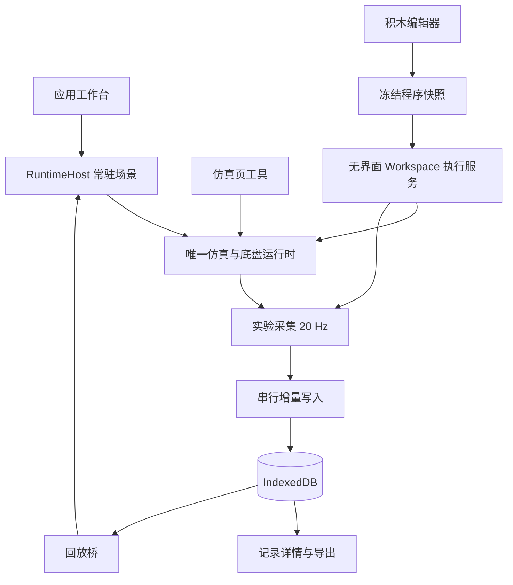

# 统一实验工作台

<!-- Created on 2026-09-27 | @author: https://github.com/Linmoqian -->

虾烤工作台把准备实验、仿真或积木运行、采集、保存和回放连接为一次本地工作流程。
本轮使用现有 React、Zustand 和领域模块，实验数据存入原生 IndexedDB。
实验采集目前面向仿真；外部项目接入、完整项目管理、以采集数据训练模型和真机控制算法改造不属于本轮实现。
设备与诊断独立页面、Studio 新建遥测连接入口、积木硬件执行入口已移除。旧程序中的串口与引脚积木仍可被读取，运行时会明确提示该指令已停用。

## 页面与操作

默认入口为 `/workbench`。首页的最近记录、样本数量与准备状态读取当前应用状态和实验数据库。

| 导航       | 页面                                                                   |
| ---------- | ---------------------------------------------------------------------- |
| 工作台总览 | 当前实验、最近记录、准备状态、常用入口                                 |
| 实验操作   | 仿真与调参、积木编程、实验记录                                         |
| 数据与智能 | 项目资产、视频与数据、文档收集、训练中心、视觉助手                       |

顶部上下文栏显示机型与运行模式。活动实验持续显示名称、时长、采样数及返回和结束操作。
宽窗口采用可调整的工具区与场景双栏；窗口宽度小于 1100 px 时，仿真和积木页切换为工具／场景选项卡。
键盘用户可使用页面跳转入口和可见焦点，开始实验弹窗使用原生对话框管理焦点。

## 一次实验的流程

1. 进入仿真或积木页，等待机型与运行时就绪。需要使用仿真通道；升级前尚未断开的真机链路需先断开。
2. 点击“开始实验”并输入名称。记录初始元信息和场景参照后开始采样，此操作不启动运动。
3. 使用关节控制、轨迹播放或积木程序运行按钮产生运动。可以切到数据页查看进度，也可以通过顶部实验栏返回。
4. 积木程序自然结束时会提示结束实验，采集继续，直到点击“结束实验”。
5. 结束会停止当前程序及仿真运动，提交最后一批数据。最终事务成功后才显示保存完成并释放实验锁。
6. 在实验记录中打开详情，查看运动曲线、程序日志、改名或导出。满足互斥条件后可进入三维回放。

采集中固定机型和数据通道。保存或回放准备期间不能重新启动运动；界面给出需要等待或处理的原因。
一个实验可以包含多次积木执行，每次运行的程序快照分别关联到实验。

## 常驻运行时与程序快照

`RuntimeHost` 在应用工作台层挂载，页面通过场景占位区改变画布位置。应用内导航不会重新创建 `SimulationLoop`、底盘、Canvas、物理世界和相机。
切到其他页面时，活动实验、程序或回放显示小型场景预览。真正切换机型时仍需重新建立对应机器人的运行时。



`programRunner` 每次运行创建独立的无界面 `Blockly.Workspace`，使用冻结快照执行。编辑器随后修改或卸载不影响这次仿真程序；运行状态、日志和取消控制由服务持有，结束后释放该 Workspace。
仿真程序可跨页继续，硬件程序离开积木页时请求停止。积木视觉当前使用合成图像，界面已标明来源。
新默认示例使用实际关节和夹爪动作。已有草稿保持原内容，旧 `move_steps` 积木仍可读取，但会明确提示该动作不产生机器人运动。

主要模块边界如下：

| 模块                                                       | 职责                                                 |
| ---------------------------------------------------------- | ---------------------------------------------------- |
| `app/frontend/src/workbench/`                                           | 常驻场景、运行时、程序快照、执行与活动互斥状态       |
| `app/frontend/src/experiments/`                                         | 实验类型、实际状态采样、增量写入、记录仓库、实验会话 |
| `app/frontend/src/videos/`                                              | 视频副本与本机路径引用的独立资源库                   |
| `app/frontend/src/components/workbench/`                                | 顶部上下文、实验操作、页面与运行时错误边界           |
| `app/frontend/src/pages/Experiments.tsx` / `ExperimentDetail.tsx`       | 列表、结果、改名、导出与回放入口                     |
| `app/frontend/src/stores/aiSessionStore.ts` / `trainingSessionStore.ts` | AI 与训练的应用内存会话                              |

## 采样与保存

采集器每 50 ms 读取当前运行时状态，标称频率为 20 Hz，不生成固定演示轨迹。相对时间使用实际经过时间，另外记录实际 Unix 毫秒时间戳。
定时器受到主线程负载和浏览器后台限速影响，不能按帧号假定每两帧严格间隔 50 ms。

| 类型                 | 内容                                                                   |
| -------------------- | ---------------------------------------------------------------------- |
| `ExperimentRecord`   | 标识、名称、来源页、状态、创建与结束时间、时长、采样数、机型、标称频率 |
| `ExperimentSnapshot` | 关节名称与面板代号映射、DXF 几何及底盘路径参照、每次程序执行快照、日志 |
| `ExperimentSample`   | 相对秒数、Unix 毫秒时间戳、实际关节角、底盘位置和航向、TCP 位置        |

内部数据使用米、弧度和秒；TCP 位置位于机械臂基座坐标系。
场景快照不包含动态道具运动帧。存档不写入 AI 配置、密钥、连接地址或个人文件路径。

“视频与数据”页另以 `xiakao-video-resources` 保存视频副本和路径引用，不写入实验存档。导入视频可在工作台预览；桌面端可通过文件管理器定位路径引用的原文件。浏览器无法直接打开任意本机路径，站点存储配额也会限制大型视频副本。

IndexedDB 数据库名为 `xiakao-experiments`，包含 `records`、`snapshots` 和 `chunks` 三个对象仓库。
每秒发起一次增量写入，将元信息、快照和新增采样在同一事务中提交。写入队列串行执行，事务成功后才推进已保存偏移和列表元信息。
数据依赖当前浏览器来源或桌面 WebView 的本地存储；切换浏览器来源或清理站点数据不会自动保留另一份记录。

保存失败后停止采集、程序和仿真运动，并保留本次会话中的采样与日志。使用“重试保存”完成提交，或“导出当前数据”取出内存记录；处理完成前不要关闭窗口。
下次启动发现仍处于采集状态的已写入记录时，将其标记为“中断”，只展示已经提交的数据，不恢复运动。
正常定时写入下可能缺失最后一批尚未提交的采样；异常退出时的损失取决于最后一次成功提交时间。

实验导出为 `kind: "claw-experiment"`、`version: 1` 的 JSON，包含记录、快照、采样及单位声明。
当前提供导出功能，尚无该格式的实验导入入口。

## 回放与旧数据兼容

有运动帧的实验可三维回放。开始前需要结束并保存活动实验、停止程序和仿真运动，并在连接页显式断开串口与 WebSocket 真机连接。
从读取记录到恢复机型与场景期间持有回放准备锁，阻止新采集、执行、连接或机型切换进入。
回放恢复记录机型、关节与底盘轨迹，以保存的 DXF 和路径作为静态参照；物理推进暂停，不重演动态道具运动。
可播放、暂停、调速或拖动时间轴；退出后返回仿真待机，不自动续跑之前的程序或轨迹。

旧 `RecordingFile v1` 保持 `claw-recording` 文件结构：关节角为度，位置为米，底盘航向为弧度，帧时间为秒。
回放桥在首帧、插值帧和末帧统一将关节角转换为弧度。文件不含可靠机型信息，需在仿真页先选择“旧录像对应机型”，再导入回放。

Blockly 原草稿和 `xiakao:data-collection:datasets:v3` 存储键保留。损坏的旧数据不被默认值覆盖；旧数据页保留可读取条目并提示修复，积木草稿损坏后需要明确重置才能重新写入。
旧固定轨迹样本显示为“旧版演示样本”，CSV／JSON 数据导入只保存字段与行数摘要。这些摘要没有运动帧，不能用于三维回放。

## AI、训练与设备边界

AI 会话状态、消息、配置和草稿，以及训练参数与结果，保存在应用共享内存中。应用内切页保留；刷新或关闭窗口不承诺恢复。
AI 配置更换仍需先成功停止活动会话；清空或停止失败会保留原会话状态并显示错误。
智能训练和对抗训练使用内置合成数据，结果记录生成时的机型上下文，尚未接入实验采集样本。

浏览器支持前端仿真、采集与回放验收。串口扫描和硬件操作、本地图片选择与模型推理仍依赖 Tauri 桌面能力；浏览器截图不能证明实际串口动作或模型输出。
跨页连续运行只涵盖应用内导航，不承诺窗口关闭或后台限速时仍维持实时仿真。

当前“串口急停”会请求读取并写回当前位置以保持扭矩，不涵盖 Studio 的 WebSocket LIVE 通道，也不代表硬件级断电。
本轮仅说明实际行为并补齐连接反馈，以下已有问题仍待独立硬件任务修复和桌面验证：

- `DeviceContext.setTarget` 将 `estopRef.current` 对象直接作为布尔条件，可能使平滑下发循环立即退出。
- 速度、电流等控制模式的现有目标下发仍使用位置写入流程，模式语义未打通。
- 串口停止与 WebSocket LIVE 控制尚未统一急停覆盖范围。

## 验证方式

以下为可复用的验收命令与检查步骤，实际运行结果见下方“本轮验证记录”。本轮不运行生产构建。

```powershell
pnpm --dir app exec tsc --noEmit
pnpm --dir app run lint
git diff --check
pnpm dlx tsx tools/verification/verify-block-program.ts
pnpm dlx tsx tools/verification/verify-block-vision.ts
pnpm dlx tsx tools/verification/experiments/verify.ts
pnpm dlx tsx tools/verification/sessions/integration/verify-sessions.ts
pnpm dlx tsx tools/verification/verify-protocol.ts
pnpm dlx tsx tools/verification/verify-collision.ts
```

`tsx` 不在当前项目依赖中，`pnpm dlx` 临时执行；本地已安装时也可用 `pnpm exec tsx`。
积木脚本覆盖冻结后修改／销毁编辑器仍按快照执行；视觉脚本覆盖 OpenCV 并发初始化、异步对象处理及合成图像颜色检测；实验脚本覆盖实际状态采样、SI 单位、旧录像 90° 的首帧／插值／末帧、损坏帧拒绝、写入失败重试与提交顺序；会话脚本使用替身 AI client 验证跨订阅状态、失败恢复和连接门禁，不调用真实模型或硬件。

启动 `pnpm --dir app run dev -- --host 127.0.0.1` 后，在 Codex 内置浏览器验收：

1. 开始实验，运行运动，切到数据页确认时长和采样数继续增加，返回场景并结束保存。
2. 刷新页面，确认记录仍存在；查看曲线和日志，回放、拖动时间轴并退出，确认不会自动恢复执行。
3. 积木运行中编辑草稿或切页，确认当前程序保持原快照；程序完成后确认实验仍在采集。
4. 在专用验收数据中检查异常关闭后的中断记录、旧录像机型选择、回放与执行／采集／连接互斥，以及旧损坏数据保留。
5. 在智能训练页运行基线后切页返回，确认参数和结果保留；视觉助手检查草稿跨页保留。真实对话与串口动作另做桌面验证。
6. 分别以 1440×900、1280×720、1024×768 检查并截图，确认主要按钮、滚动区域、窄窗选项卡和弹窗焦点可用。

失败保存的脚本验证使用可控写入替身；实际 IndexedDB 写入与刷新后读取需要浏览器验收。验收截图可保存在被忽略的 `.artifacts/workbench/`，不提交生成文件。

## 本轮验证记录

静态检查 `pnpm exec tsc --noEmit`、全仓 `pnpm run lint` 和 `git diff --check` 均通过。
上述六个针对性脚本全部通过：积木程序、积木视觉、实验记录、页面会话、协议和碰撞验证。

Codex 内置浏览器完成了以下检查：

| 检查             | 实际结果                                                                                                                                    |
| ---------------- | ------------------------------------------------------------------------------------------------------------------------------------------- |
| 仿真实验闭环     | 跨页持续采集 725 帧，完成保存；刷新后记录仍在，可查看曲线并进入回放，暂停、拖动时间轴与退出均可用                                           |
| 积木视觉与运动   | 合成图像的 RED 检测返回中心 `(275, 235)`；实际夹爪采样首帧为 `0 rad`，末帧为 `-0.09 rad`；保存 612 帧并包含程序快照和日志，保存完成提示可见 |
| 改名与导出       | 记录改名后成功导出 1565 帧 JSON，文件实际落入 Downloads；检查了导出结构和角度单位 `rad`                                                     |
| AI 页面状态      | 未发送草稿在页面切换后保留；请求生命周期和失败恢复由替身 AI client 脚本验证，未执行真实模型推理                                             |
| 训练页面状态     | 内置合成数据的感知基线训练完成 32 轮，显示准确率 98.6%；切页返回后参数和结果保留，该指标仅反映此次合成数据运行                              |
| 窗口与操作可达性 | 已截图检查 1440×900、1280×720、1024×768；窄窗工具／场景选项卡可用，Studio STOP 操作固定可达                                                 |
| 调试中断恢复     | HMR 和 OpenCV 调试造成的中断记录保留并标为“中断”，没有自动恢复运动                                                                          |

验收过程中修复了 `decision_if` 字段读取错配、合法空 Blockly 草稿 `{}` 被误判损坏，以及 OpenCV 自身带 `then` 方法和 Vite CommonJS 动态导入共同导致的初始化冻结问题；同时修正图像转换及 `inRange` 参数。
这些修复保留已有积木草稿，旧 `move_steps` 的兼容读取与非运动提示也已保留。

保存失败与重试使用可控写入替身验证，没有在真实磁盘上模拟失败。浏览器已验证实际 IndexedDB 保存和刷新读取，但这些检查不能代替真实串口动作或真实模型推理；两项桌面能力本轮均未验证，也未运行生产构建。
本轮截图保存在被 `.gitignore` 忽略的 `.artifacts/workbench/`，不提交截图生成文件。
